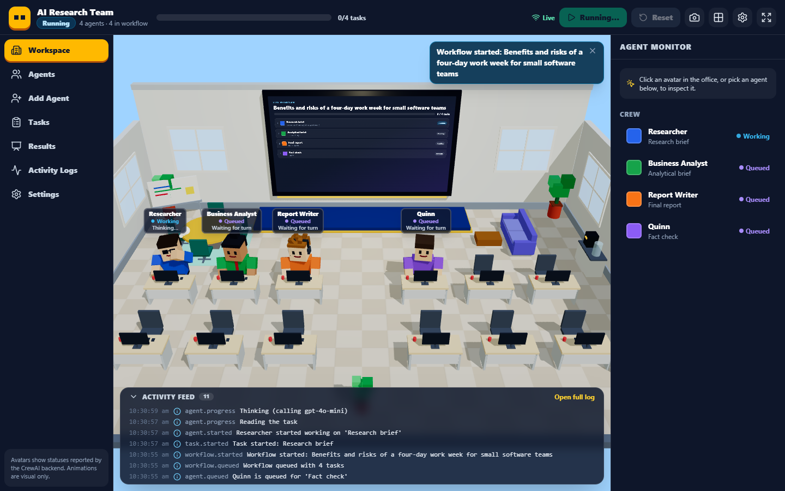
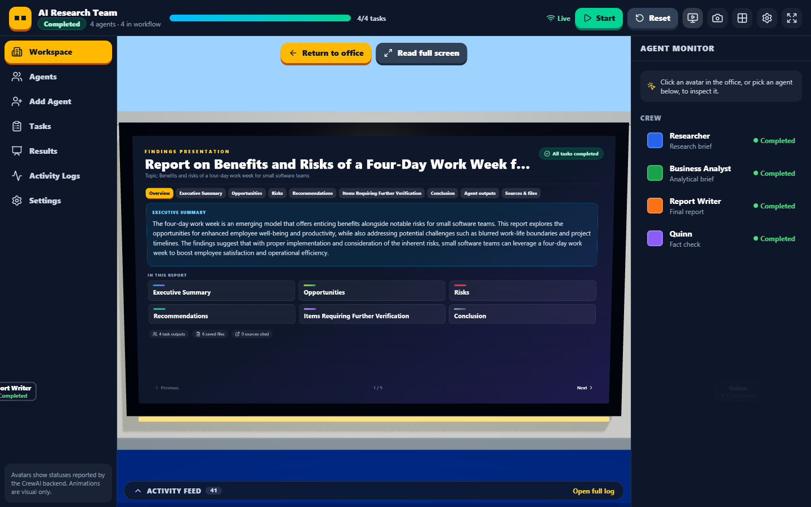
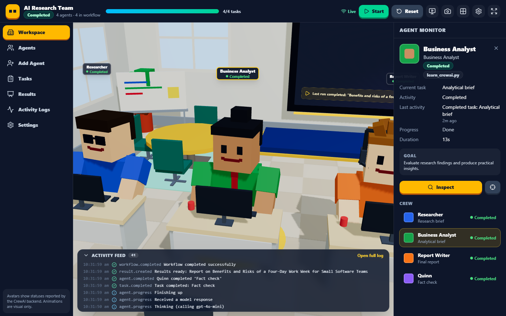

# CrewAI Workplace

A blocky 3D office where the agents from `learn_crewai.py` (Researcher, Business Analyst and Report Writer, plus any agents you add) sit at their desks while the **real** CrewAI workflow runs. Statuses, the task board and the activity feed are driven by CrewAI's own events, and the finished report is presented on a giant wall screen.



The original command-line script still works exactly as before (`python learn_crewai.py`).

## What you get

- **3D office**: procedural blocky avatars with idle, queued, working, thinking, completed and error animations; desks, a meeting area and a presentation wall. Orbit, zoom and pan the camera; switch to top-down; click an avatar to focus it.
- **Live workflow**: Start runs the real crew in the background on the backend. Each run gets an ID; a second start while one is running is refused.
- **Real-time updates over WebSocket**, with automatic reconnection and a full state resync on every connect.
- **Agent management**: create custom agents in a validated form (role, goal, backstory, an optional task, approved model, tools from an allowlist, appearance and desk). Enabled custom agents run after the original three and receive their outputs as context.
- **Results**: the final report is split into sections and shown on the wall automatically. Tables become charts only when they contain numbers. Sources are listed only if the report actually contains links. Every task output and the report can be downloaded.
- **Persistence**: agents, runs, tasks, events and results are stored in SQLite (`data/workplace.db`). Run files are written to `runs/<run_id>/`.



## Requirements

- Windows 10/11 with PowerShell
- Python 3.12 (the existing `venv` in this folder is fine)
- Node.js 20 or newer
- An OpenAI API key
- A browser with WebGL (current Edge, Chrome or Firefox)

## Setup (PowerShell)

Run these from the project folder (`MyOffice`).

```powershell
# 1. Python environment (skip creation if .\venv already exists)
py -3.12 -m venv venv
.\venv\Scripts\python.exe -m pip install -r backend\requirements.txt

# 2. Secrets: copy the template, then edit .env and paste your key
Copy-Item .env.example .env
notepad .env

# 3. Frontend dependencies
cd frontend
npm install
cd ..
```

`.env` is ignored by git. The key is read only by the backend and is never sent to the browser.

## Start

Use two PowerShell windows:

```powershell
.\start-backend.ps1     # FastAPI on http://127.0.0.1:8000
```

```powershell
.\start-frontend.ps1    # Vite on http://127.0.0.1:5173
```

Open <http://127.0.0.1:5173>.

If PowerShell refuses to run the scripts, run them with `powershell -ExecutionPolicy Bypass -File .\start-backend.ps1`, or start the servers by hand:

```powershell
cd backend;  ..\venv\Scripts\python.exe -m uvicorn app.main:app --host 127.0.0.1 --port 8000
cd frontend; npm run dev
```

## Using it

1. **Start** (top bar): enter a research topic and confirm. This makes real OpenAI calls and uses your credits. Avatars change to *Queued* and then *Working*, and the wall shows a live task board.
2. **Click an avatar** (or pick one in the right-hand panel) to see its role, current task and latest activity. Progress is shown as "Working" because CrewAI reports only when a task starts and finishes, not a percentage.
3. When the run completes, the findings open on the wall. Use the section tabs, **Read full screen** for a larger reading view, and **Return to office** to go back. **Show findings** in the top bar reopens the latest result.
4. **Add Agent** (sidebar): fill in the form. Tick *Include in future workflow runs* and give the agent a task so it joins the next run after the Report Writer. Only `{topic}` may be used as a placeholder. The built-in agents' prompts come from `learn_crewai.py`; in the UI you can change only their name, look and desk.
5. **Tasks**, **Results** and **Activity Logs** show the task board, previous runs with downloads, and a searchable event log.
6. **Reset** returns all avatars to idle and clears the current run from the screen. Stored runs and results are kept.



## Tests

```powershell
# Backend (uses a fake LLM; no OpenAI calls)
cd backend
..\venv\Scripts\python.exe -m pytest

# Optional: one real CrewAI run against OpenAI (uses credits)
$env:RUN_REAL_CREWAI = "1"; ..\venv\Scripts\python.exe -m pytest -m integration; Remove-Item Env:RUN_REAL_CREWAI
```

```powershell
# Frontend
cd frontend
npm test            # unit and component tests (Vitest)
npm run lint
npm run typecheck
npm run build

# With both servers running: headless browser checks using the installed Microsoft Edge
npm run smoke                  # office renders, labels, avatar selection, cameras
node scripts/e2e-real.mjs      # creates a custom agent and runs the real workflow (uses credits)
```

Screenshots from the browser checks are saved to `frontend/smoke-output/`.

## Troubleshooting

| Symptom | Fix |
| --- | --- |
| "Connecting to the backend…" never goes away | The backend is not running on port 8000. Start it with `.\start-backend.ps1` and check its window for errors. |
| Start fails with "OPENAI_API_KEY is not configured on the backend" | Set `OPENAI_API_KEY` in `.env` and restart the backend. `GET /api/health` shows `openai_key_configured`. |
| Start fails with "A workflow is already running" | Only one run at a time. Wait for it to finish. |
| A run shows *Failed: Interrupted* | The backend stopped during that run. Runs cannot resume; start a new one. |
| Port already in use | Find the process with `Get-NetTCPConnection -LocalPort 8000` (or 5173) and stop it. |
| The office area is blank or shows "could not be displayed" | WebGL is unavailable. Enable hardware acceleration in the browser, or try another browser. |
| Start fails with "tool 'web_search' is unavailable" | An enabled custom agent uses `web_search`, which needs `SERPER_API_KEY` in `.env`. Add the key, or remove the tool from that agent. |

Error responses never include stack traces or secrets. Details are in the backend console.

## Limitations

- **No pause or cancel.** CrewAI has no safe way to stop a crew mid-run, so the UI doesn't offer a button that would only pretend to stop it.
- One run at a time. The workflow is sequential: the three original agents first, then enabled custom agents in their configured order.
- Animations reflect statuses reported by the backend. An animated avatar is a visual cue, not proof of work; the activity log shows the underlying events.
- Custom agents can use only the allowlisted tools (`calculator`, `fetch_webpage`, `web_search`) and approved models. Code, imports, shell commands and file paths cannot be configured from the UI.
- This is a local, single-user app with no authentication. Keep it bound to `127.0.0.1`.

## Project layout

```
learn_crewai.py        original crew, refactored into build_agents / build_tasks / build_crew
backend/app/           FastAPI app (API, WebSocket, workflow manager, SQLite, results)
backend/tests/         pytest suite (fake LLM) and an opt-in real integration test
frontend/src/three/    3D office, avatars, camera, presentation wall
frontend/src/          React UI, Zustand store, API and WebSocket clients
docs/                  PROJECT_ANALYSIS, ARCHITECTURE and API references
data/, runs/           created at runtime (gitignored)
```

See [docs/ARCHITECTURE.md](docs/ARCHITECTURE.md) and [docs/API.md](docs/API.md) for details.
