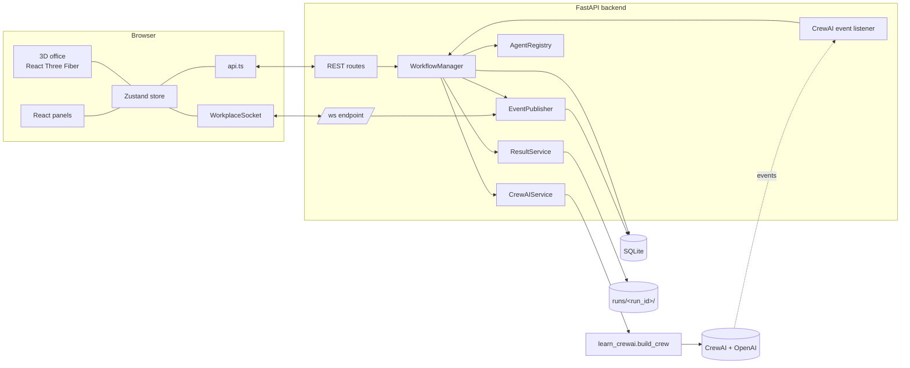

# Architecture

## Overview

The browser never talks to OpenAI and never sees the API key. Only the backend imports CrewAI, and it builds every crew through the original `learn_crewai.py`.

## Backend (`backend/app`)

| Module | Responsibility |
| --- | --- |
| `core/config.py` | Settings (`WORKPLACE_*` environment variables), paths, approved models, CORS origins. Puts the project root on `sys.path` so `learn_crewai` can be imported. |
| `core/errors.py` | Typed errors (`NotFoundError` 404, `ConflictError` 409, `ValidationFailed` 422, `NotReadyError` 503) and a handler that returns `{"error": {"code", "message", "details"}}`. Unexpected errors return a generic 500 without a trace. |
| `database/` | SQLAlchemy models, a session helper (SQLite in WAL mode) and numbered migrations recorded in `schema_version`. |
| `projects/` | `ProjectDefinition` abstraction. `ResearchTeamProject` exposes the three built-in agents and builds the crew with `learn_crewai.build_crew`. |
| `services/agent_registry.py` | Built-in and custom agents. Built-ins are re-seeded from Python on every start, so their prompts always match `learn_crewai.py`. Custom agents are validated data. |
| `services/crewai_service.py` | The only module that creates CrewAI objects. It plans the task list (built-ins first, then enabled custom agents by `workflow_order`) and turns validated custom agents into `Agent` and `Task` objects. |
| `services/workflow_manager.py` | Run lifecycle, in-memory runtime status per agent, mapping of CrewAI events to app events, recovery after restart and workspace reset. |
| `services/event_publisher.py` | Persists each event, assigns its id, then fans it out to WebSocket subscribers. |
| `services/crewai_listener.py` | Registers handlers on CrewAI's global event bus once and forwards them to the manager. |
| `services/result_service.py` | Per-run files, the safe-path check, and turning the final Markdown into a structured presentation result. |
| `services/tool_registry.py` and `tools/` | The tool allowlist: `calculator` (AST-based arithmetic only), `fetch_webpage` (public http/https only, size and time limits, no redirects) and `web_search` (Serper, only when `SERPER_API_KEY` is set). |
| `api/` | REST routes and the WebSocket endpoint. Routes contain no business logic. |

### Run lifecycle

1. `POST /api/projects/{id}/runs` calls `WorkflowManager.start_run`. It checks, in order:
   - **No other active run.** Otherwise it returns 409 with the active `run_id`.
   - **Inputs are valid.** Only known fields are accepted, with a length limit, and control characters are stripped.
   - **The API key is present.** Otherwise it returns 503.
   - **Every custom participant is runnable.** Tools must be available, the model approved, and the task complete; otherwise it returns 422.
2. A `run_<12 hex>` record and one task record per planned task are written. `agent.queued` and `workflow.queued` are published, and a daemon thread starts.
3. The thread builds a **fresh** crew (`learn_crewai.build_crew` with the custom agents and tasks appended), maps CrewAI task and agent ids to the stored records, and calls `kickoff`.
4. CrewAI events arrive on CrewAI's thread pool, possibly out of order. Statuses only move forward:
   - Agents: `idle` → `queued` → `working` → `completed` or `error`.
   - Tasks: `pending` → `running` → `completed` or `failed`.

   A late "started" event can therefore never overwrite "completed".
5. After `kickoff` returns, the manager flushes the event bus and finalises every task from `CrewOutput.tasks_output`. It then writes the files, builds the result, and publishes `result.created`, then `workflow.completed`.
6. On an exception, running tasks are failed, queued agents go back to idle, the error message is redacted (`sk-…` keys and `Bearer` tokens are removed), and a **partial** result is saved if any task finished. Then `workflow.failed` is published.
7. On startup, any run still marked queued or running is marked failed ("Interrupted…"). CrewAI runs can't be resumed.

There is no pause or cancel: `kickoff()` has no cooperative cancellation, and killing a thread is unsafe.

### Events and real-time sync

- Every change is an `EventRecord` with a monotonically increasing integer id. The id is assigned inside a lock at insert time, then the event is broadcast with `loop.call_soon_threadsafe`.
- On connect, the WebSocket handler **subscribes first, then sends a snapshot** (`GET /api/state` payload, including `last_event_id`). An event can't fall into the gap: anything published after the subscription is either in the snapshot or queued.
- The client ignores events with `id <= lastEventId`, which removes duplicates and anything already reflected in the snapshot.
- Each subscriber has a bounded queue of 1000 events. If a slow client overflows it, the server sends `{"kind": "resync"}` followed by a fresh snapshot.
- The client sends `ping` every 15 seconds and reconnects with exponential backoff (up to 10 seconds) when no traffic arrives for 40 seconds. Every reconnect gets a new snapshot.

### Results

- `runs/<run_id>/tasks/NN_<key>.md` holds each task's raw output, and `runs/<run_id>/report.md` holds the final report, which is also copied to the root `report.md` as before. `runs/<run_id>/result.json` stores the presentation result.
- `split_sections` splits the report on `##` headings (ignoring fenced code) and classifies headings (summary, findings, recommendations, risks, and so on). The summary is taken only from an explicit summary section.
- `extract_sources` lists only links and URLs that literally appear in the text. Nothing is generated.
- The status is `completed`, `partial` (with a warning naming the missing tasks) or `failed`.
- Artifacts are looked up **by id** in the database. The stored relative path must resolve inside `runs/`, and API parameters are never used as file paths.

### Persistence

SQLite at `data/workplace.db`, with these tables:

- `agents`
- `runs`
- `run_tasks`
- `events`
- `artifacts`
- `settings`
- `schema_version`

`settings` holds the app settings and `current_run_id`. Migrations are Python functions in `database/migrations.py`, applied in order at startup.

## Frontend (`frontend/src`)

| Area | Files |
| --- | --- |
| Types and clients | `types/api.ts` mirrors the backend schemas. `services/api.ts` is a typed REST client with `ApiError`. `services/socket.ts` handles reconnecting, heartbeats, and an injectable factory for tests. |
| Sync | `lib/sync.ts` holds the pure `applySnapshot` and `applyEvent` functions (deduplication, new-run reset, task and progress updates, registry changes). They are unit tested. |
| Store | `stores/workplaceStore.ts` (Zustand) contains the synced state plus UI state: selection, camera mode, open panel, presentation, toasts, and preferences stored in `localStorage`. |
| 3D | `three/`: `OfficeScene` (canvas and desk allocation), `AgentAvatar` (pivot-based procedural animation), `AgentWorkstation`, `Furniture`, `OfficeEnvironment`, `MeetingArea`, `CameraController` (animated modes that cancel on user input) and `PresentationScreen`. |
| UI | `components/layout` (top bar, sidebar, right agent monitor, activity feed, dialogs), `components/agents` (form, list, details, live avatar preview), and `components/presentation` (Markdown, charts, section pager). Also the task board, activity log, results and settings panels. |

### 3D notes

- All blocks share one unit `BoxGeometry` and a material cache per colour, and the desks are memoised.
- The wall screen is real DOM rendered with Drei `<Html transform>`, so the report stays crisp and selectable in the reading view. With `distanceFactor = 9 / 1600 × 400 = 2.25`, a 1600 × 900 CSS-pixel page covers the 9 × 5.06-unit screen.
- Every Drei `<Html>` is given a fixed `portal` host element created before the canvas mounts. Otherwise Drei switches its mount target after the first frame and recreates its React root, which left the wall screen empty.
- React `StrictMode` is not used for the same reason: its dev-only double mount unmounts those separate roots mid-render.
- Wide camera shots pull back on narrow (portrait) viewports. A hidden or zero-size canvas falls back to a landscape aspect so the camera never becomes NaN.
- A `SceneErrorBoundary` keeps the panels usable if WebGL fails.

## Security summary

- **Secrets:** the API key is only on the backend. `.env` is gitignored, and error messages are redacted before they reach events or the UI.
- **No code from the UI:** custom agents are plain fields (text, tool keys, model) with `extra="forbid"` schemas. Tools come from a fixed registry, models from an allowlist, and placeholders are limited to the project inputs (`{topic}`).
- **Files:** downloads are by artifact id only, and paths are re-validated to be inside `runs/`.
- **Network tools:** `fetch_webpage` refuses private, loopback and link-local addresses, does not follow redirects, and caps size and time.
- **CORS** is restricted to the local Vite origins. The app has no authentication, so keep it on `127.0.0.1`.

## Extending

- **New tool:** implement a `BaseTool` in `tools/`, register it in `TOOL_REGISTRY` with any `requires_env`, and it appears in the form automatically.
- **New project or crew:** subclass `ProjectDefinition` (built-in agent specs, inputs, `build_crew`) and add it to `projects/PROJECTS`.
- **New model:** add it to `WORKPLACE_ALLOWED_MODELS`.
